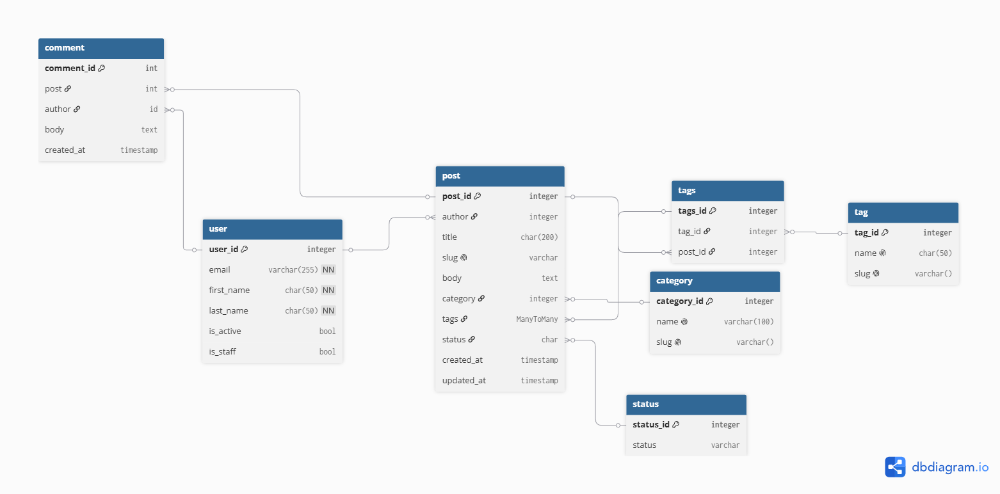

# Blog API
ERD of a database


# Seed command
Seed command fills all models with generated fake data: users, categories, tags, posts, comments.

- File: apps/blog/management/commands/seed.py
- Run: python manage.py seed

Seed acceps arguments:
| Argument     | Default | Description                         |
|--------------|---------|-------------------------------------|
| `--users`    | `20`    | Number of users to create           |
| `--posts`    | `100`   | Number of posts to create           |
| `--comments` | `500`   | Number of comments to create        |
| `--clear`    | off     | Delete existing data before seeding |

## Example:
1. No arguments
```
python manage.py seed
```
Output:
Seeding completed!
Categories: 8
Tags: 20
Posts: 100
Comments: 500
Time: 10.11 seconds

2. With arguments
```
python manage.py seed --users 5 --posts 10 --comments 20
```
Output:
Seeding completed!
Categories: 8
Tags: 20
Posts: 10
Comments: 20
Time: 10.02 seconds