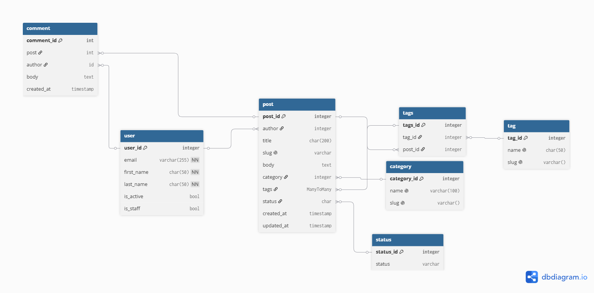

# Blog API
ERD of a database


# Seed command
Seed command fills all models with generated fake data: users, categories, tags, posts, comments.

- File: apps/blog/management/commands/seed.py
- Run: python manage.py seed

Seed acceps arguments:
| Argument     | Default | Description                         |
|--------------|---------|-------------------------------------|
| `--users`    | `20`    | Number of users to create           |
| `--posts`    | `100`   | Number of posts to create           |
| `--comments` | `500`   | Number of comments to create        |
| `--clear`    | off     | Delete existing data before seeding |

## Example:
1. No arguments
```
python manage.py seed
```
Output:
Seeding completed!
Categories: 8
Tags: 20
Posts: 100
Comments: 500
Time: 10.11 seconds

2. With arguments
```
python manage.py seed --users 5 --posts 10 --comments 20
```
Output:
Seeding completed!
Categories: 8
Tags: 20
Posts: 10
Comments: 20
Time: 10.02 seconds
# Queries
50 Django ORM queries live in `apps/blog/queries.py` (one function per query, mapped by number in the `QUERIES` dict).
The `queries` command runs them and shows the result and the number of SQL queries.

- File: apps/blog/management/commands/queries.py

| Run                                         | What it does                                          |
|---------------------------------------------|-------------------------------------------------------|
| `python manage.py queries`                  | Runs all queries except 40–44 (they change the data)  |
| `python manage.py queries --number 31`      | Runs only query 31 (works for 40–44 too)              |
| `python manage.py queries --number 6 --sql` | Also prints the SQL that Django sent to the database  |

Queries 40–44 change the data. To get fresh data run `python manage.py seed --clear`.

## Example:
```
python manage.py queries --number 31
```
Output:
```
#31 categories_with_post_count — 1 SQL query
  Python {'post_count': 16}
  Web Development {'post_count': 14}
  JavaScript {'post_count': 12}
  DevOps {'post_count': 11}
  Software Engineering {'post_count': 11}
  (8 rows)
```

```
python manage.py queries --number 6 --sql
```
Output:
```
#6 has_drafts — 1 SQL query
SELECT 1 AS "a" FROM "blog_post" WHERE "blog_post"."status" = 'draft' LIMIT 1
  True
```
